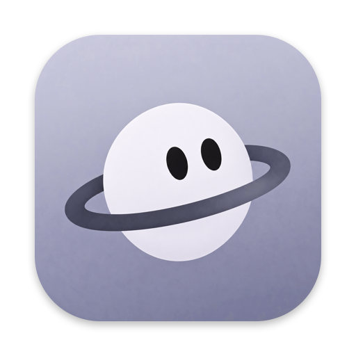

<p align="center">
  
</p>

<h1 align="center">mica</h1>

<h3 align="center">Браузер без телеметрии.</h3>

<p align="center">
  Для macOS и Windows 10+. История, закладки и пароли хранятся локально.<br>
  Встроенная блокировка рекламных и отслеживающих доменов.
</p>

<p align="center">
  <a href="https://github.com/workedErnesto/mica/releases/latest"></a>&nbsp;&nbsp;
  <a href="#установка"></a>&nbsp;&nbsp;
  <a href="docs/WINDOWS.md"></a>
</p>

<p align="center">
  &nbsp;&nbsp;
  &nbsp;&nbsp;
  
</p>
<p align="center">
  &nbsp;&nbsp;
  
</p>

<p align="center">
  <a href="https://github.com/workedErnesto/mica/releases/latest"><strong>Скачать mica</strong></a>
  &nbsp; / &nbsp;
  <a href="#возможности">Возможности</a>
  &nbsp; / &nbsp;
  <a href="#сборка">Сборка</a>
  &nbsp; / &nbsp;
  <a href="#документация">Документация</a>
</p>

<br>

<h2 align="center">Приватность</h2>

**Без собственной телеметрии.** mica не отправляет разработчику историю посещений и статистику использования браузера.

**Локальное хранение.** История, закладки, настройки и пароли остаются на вашем устройстве. Пароли зашифрованы, ключ хранится в Связке ключей macOS. Для окон инкогнито используются отдельные хранилища.

**Блокировка сторонних доменов.** Встроенный список Peter Lowe ограничивает запросы к рекламным и отслеживающим доменам. Для нужных сайтов можно добавить исключения.

**Контроль разрешений.** Доступ к камере, микрофону и уведомлениям требует вашего согласия. Перед запуском расширения mica показывает запрашиваемые им права.

Иконки популярных сайтов встроены в приложение. Для остальных mica ищет favicon на самом сайте, затем обращается к сервису иконок DuckDuckGo, передавая только домен, без адреса страницы и cookie. Локальные адреса и нестандартные порты в этот сервис не отправляются.

Сайты, поисковик, сервис иконок, расширения и сама ОС могут обращаться к сети и собирать данные. Встроенная блокировка не гарантирует анонимность.

<br>

<h2 align="center">Возможности</h2>

### Вкладки без выгрузки по таймеру

Открытые страницы остаются живыми. После перезапуска mica восстанавливает сессию, а случайно закрытую вкладку можно вернуть сочетанием ⌘⇧T.

### Настраиваемый интерфейс

Разместите вкладки слева, справа или сверху, сверните боковую панель до иконок и переставьте кнопки шапки. Светлая и тёмная темы, свой акцентный цвет, русский и английский языки. Движение и прозрачность учитывают системные настройки доступности.

### Профили для разных задач

У каждого окна могут быть свои закреплённые вкладки, начальная страница, язык и оформление. История, закладки, пароли и вход на сайты остаются общими.

### Адрес, поиск и переход между вкладками

Нажмите ⌘L и начните вводить адрес или запрос. Подсказки находят открытые вкладки, закладки и страницы из истории.

### Сохранение страниц

PDF, PNG, JPEG или один HTML-файл со встроенными изображениями, стилями и шрифтами. Формат и место сохранения выбираете вы; готовый файл появляется в загрузках.

### Расширения и перенос данных

Совместимые расширения из Chrome Web Store и Firefox Add-ons: [поддержка и ограничения](docs/EXTENSIONS.md). Историю и закладки можно перенести из других браузеров.

Закладки, история, загрузки с повтором, поиск на странице, печать и окна инкогнито тоже доступны.

<br>

<h2 align="center">Расход ресурсов</h2>

Замеры на MacBook Air M1, 8 ГБ памяти, macOS 15.7.5. Release-сборка, блокировщик включён, все вкладки живые.

1. **Пустое окно:** 22 МиБ памяти, готовность за 0,50 с. Фоновый CPU не измерялся.
2. **Одна страница:** 163 МиБ памяти, готовность за 0,28 с, фоновый CPU 0,24%.
3. **Десять живых вкладок:** 1,5 ГиБ памяти, готовность за 0,27 с, фоновый CPU 4,6%.

Память включает приложение и процессы страниц, графики и сети; CPU указан в долях одного ядра. Тёплый запуск — до готовности первого окна, без ожидания загрузки сайтов. Это результаты конкретного прогона: [методика и исходные данные](docs/PERFORMANCE.md).

<br>

<h2 align="center">Установка</h2>

1. Скачайте DMG из [последнего релиза](https://github.com/workedErnesto/mica/releases/latest).
2. Откройте образ и перенесите mica в «Программы».
3. Запустите приложение. Нужна macOS 15.4 или новее.

Сборка подписана локально и не заверена Apple. Если macOS заблокирует первый запуск, подтвердите открытие в «Системных настройках», разделе «Конфиденциальность и безопасность».

Обновления приходят из релизов GitHub. Проверка выполняется раз в сутки и отключается в настройках. Замена приложения сохраняет профиль: историю, закладки, пароли, настройки и сессию.

**Windows 10+:** требуется Windows 10 версии 2004 (сборка 19041) или новее. Версия на WinUI 3 и WebView2 собирается в CI, но ещё не проверена в работающем приложении. [Сборка и установка](docs/WINDOWS.md), [различия платформ](docs/PARITY.md).

<br>

<h2 align="center">Полезно знать</h2>

1. Ключи доступа (passkeys) на macOS пока недоступны из-за ограничений WebKit для сторонних браузеров.
2. Уведомления сайтов работают, пока страница открыта. Push после закрытия сайта не поддерживается.
3. Встроенный блокировщик работает по доменам. Расширения могут предоставлять более широкие возможности фильтрации.
4. Совместимость расширений зависит от доступных API WebKit. Поддерживаются не все расширения магазинов.

<details>
<summary><strong>Сочетания клавиш на macOS</strong></summary>

1. <kbd>⌘</kbd> <kbd>L</kbd> — адрес и поиск
2. <kbd>⌘</kbd> <kbd>T</kbd> — новая вкладка
3. <kbd>⌘</kbd> <kbd>N</kbd> — новое окно
4. <kbd>⌘</kbd> <kbd>⇧</kbd> <kbd>N</kbd> — окно инкогнито
5. <kbd>⌘</kbd> <kbd>W</kbd> — закрыть вкладку
6. <kbd>⌘</kbd> <kbd>⇧</kbd> <kbd>T</kbd> — вернуть закрытую вкладку
7. <kbd>Control</kbd> <kbd>Tab</kbd> / <kbd>Control</kbd> <kbd>Shift</kbd> <kbd>Tab</kbd> — следующая / предыдущая вкладка
8. <kbd>Control</kbd> <kbd>⌘</kbd> <kbd>S</kbd> — боковая панель
9. <kbd>⌘</kbd> <kbd>F</kbd> — поиск на странице
10. <kbd>⌘</kbd> <kbd>D</kbd> — добавить закладку
11. <kbd>⌘</kbd> <kbd>Y</kbd> — история
12. <kbd>⌘</kbd> <kbd>⇧</kbd> <kbd>J</kbd> — загрузки
13. <kbd>⌘</kbd> <kbd>S</kbd> — сохранить страницу
14. <kbd>⌘</kbd> <kbd>,</kbd> — настройки

</details>

<br>

<h2 align="center">Сборка</h2>

Для macOS нужны Xcode 26.1 и Command Line Tools.

```sh
git clone https://github.com/workedErnesto/mica.git
cd mica/macos
scripts/install.sh
```

Скрипт запускает тесты, собирает release и устанавливает приложение в «Программы». Чтобы только собрать приложение, выполните `scripts/build.sh release`. Результат: `macos/build/mica.app`.

<details>
<summary><strong>Стек и сборка Windows</strong></summary>

macOS: Swift 6, AppKit, SwiftUI и системный WebKit, без сторонних Swift-зависимостей. Windows: C#, .NET 10, WinUI 3 и WebView2.

Токены дизайна, строки, клавиши и глифы хранятся в `shared/` и генерируются для обеих платформ. Подробнее: [архитектура](docs/ARCHITECTURE.md).

Из корня репозитория, с установленным .NET SDK:

```sh
dotnet build windows/mica.sln
```

На Windows для установки используйте `windows/scripts/install.ps1`. Требования и проверка в живом приложении: [руководство Windows](docs/WINDOWS.md).

</details>

<br>

<h2 align="center">Документация</h2>

<p align="center">
  <a href="docs/ARCHITECTURE.md">Архитектура</a> &nbsp; / &nbsp;
  <a href="DESIGN.md">Дизайн</a> &nbsp; / &nbsp;
  <a href="docs/PERFORMANCE.md">Производительность</a> &nbsp; / &nbsp;
  <a href="docs/EXTENSIONS.md">Расширения</a>
</p>
<p align="center">
  <a href="docs/VALIDATION.md">Результаты проверок</a> &nbsp; / &nbsp;
  <a href="docs/WINDOWS.md">Windows</a> &nbsp; / &nbsp;
  <a href="docs/PARITY.md">Различия платформ</a>
</p>
